# CellMol_SexChrom_Bicyclus_anynana

## Sex-Chromosome Dosage in Bicyclus anynana Using NCBI, Galaxy, and R

**Student:** Deguit, Zenas Charis C.  
**Course:** Cell and Molecular Biology  
**Selected species:** Bicyclus anynana (Squinting bush brown butterfly)  
**Sex-chromosome system:** ZZ/ZW

---

## 1. Introduction

This laboratory activity aims to estimate the sex-chromosome complement of Bicyclus anynana using whole-genome sequencing (WGS) reads and chromosome-level read-depth analysis.

The species has a ZZ/ZW sex-determination system, in which males typically have ZZ chromosomes and females have ZW chromosomes.

By aligning WGS reads to a reference genome and comparing the sequencing depth of chromosome Z with the median depth of autosomes, the sex-chromosome complement of the WGS donor can be inferred.

The activity uses NCBI for genomic data, Galaxy for sequence processing and alignment, and R for chromosome-depth calculations and visualization.

### Study Question

Can the sex-chromosome complement of a Bicyclus anynana WGS donor be inferred from the ratio of chromosome Z sequencing depth to autosomal sequencing depth?

---

## 2. Objectives

1. Identify a suitable chromosome-level nuclear genome assembly for Bicyclus anynana.
2. Retrieve publicly available WGS DNA reads from the same species.
3. Perform quality assessment, read trimming, and sequence alignment using Galaxy.
4. Calculate chromosome coverage using Samtools.
5. Determine the Z:A sequencing-depth ratio using R.
6. Compare the inferred sex-chromosome complement with the WGS donor's BioSample metadata.

---

## 3. Selected Species and NCBI Data

### 3.1 Reference Genome

| Information | Details |
|---|---|
| Scientific name | Bicyclus anynana |
| Common name | Squinting bush brown butterfly |
| Assembly accession | GCF_947172395.1 |
| Assembly name | ilBicAnyn1.1 |
| Assembly level | Chromosome |
| Assembly BioSample | SAMEA9252597 |
| Genome size | 457.2 Mb |
| Number of chromosomes | 28 |
| Sex-chromosome system | ZZ/ZW |
| Identified Z chromosome | NC_069110.1 |

**NCBI Genome Assembly:**  
https://www.ncbi.nlm.nih.gov/datasets/genome/GCF_947172395.1/

**NCBI Chromosome Z:**  
https://www.ncbi.nlm.nih.gov/nuccore/NC_069110.1

### Genome Assembly Evidence

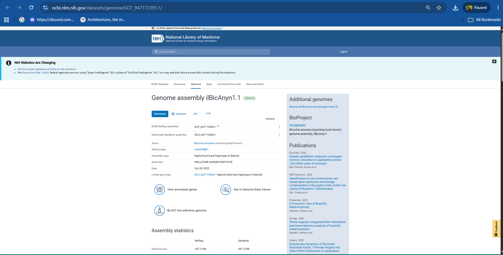

*Figure 1. NCBI reference genome assembly ilBicAnyn1.1 for Bicyclus anynana.*

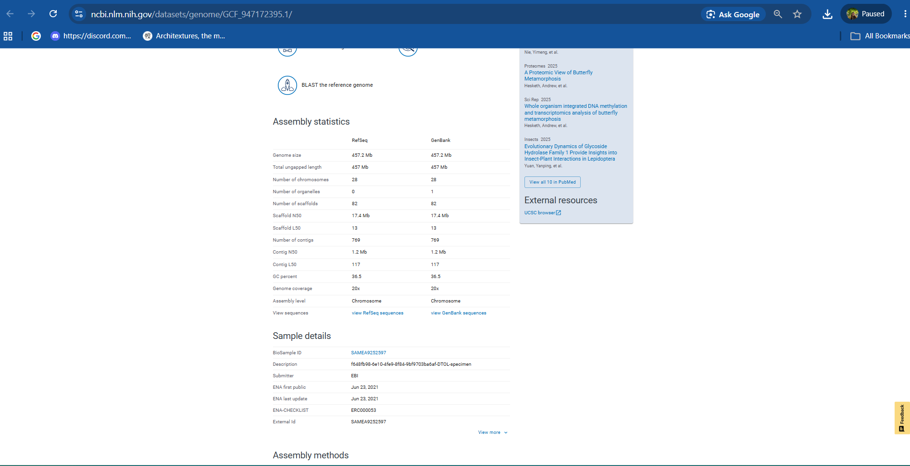

*Figure 2. Assembly statistics confirming chromosome-level organization and the assembly BioSample accession.*

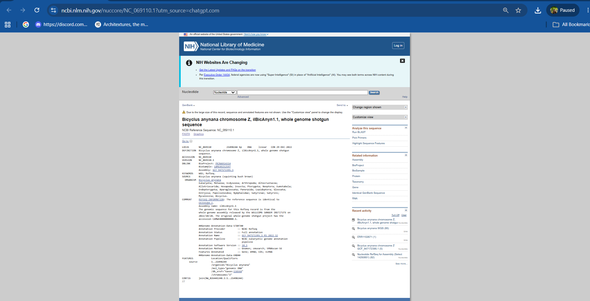

*Figure 3. NCBI sequence record identifying chromosome Z (NC_069110.1).*

### 3.2 Whole-Genome Sequencing Data

| Information | Details |
|---|---|
| WGS run accession | ERR754051 |
| Experiment accession | ERX697772 |
| WGS BioSample | SAMEA3245887 |
| Sequencing platform | Illumina MiSeq |
| Library strategy | WGS |
| Library source | GENOMIC |
| Library selection | RANDOM |
| Library layout | PAIRED |
| Run size | Approximately 611.8 MB |
| Same assembly and WGS BioSample? | No |
| Recorded WGS donor sex | Female |

**NCBI SRA Run:**  
https://www.ncbi.nlm.nih.gov/sra/?term=ERR754051

**ENA WGS BioSample:**  
https://www.ebi.ac.uk/ena/browser/view/SAMEA3245887

The assembly and WGS reads have different BioSample accessions, indicating that they come from different samples. Therefore, the chromosome-dosage inference refers to the WGS donor rather than the reference assembly donor.

### WGS Evidence

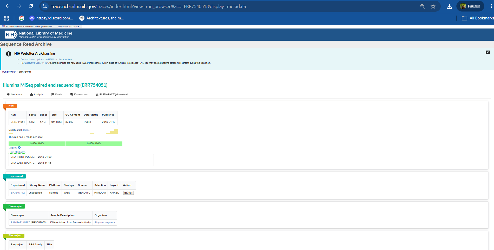

*Figure 4. WGS experiment details showing Illumina paired-end sequencing and the genomic DNA library.*

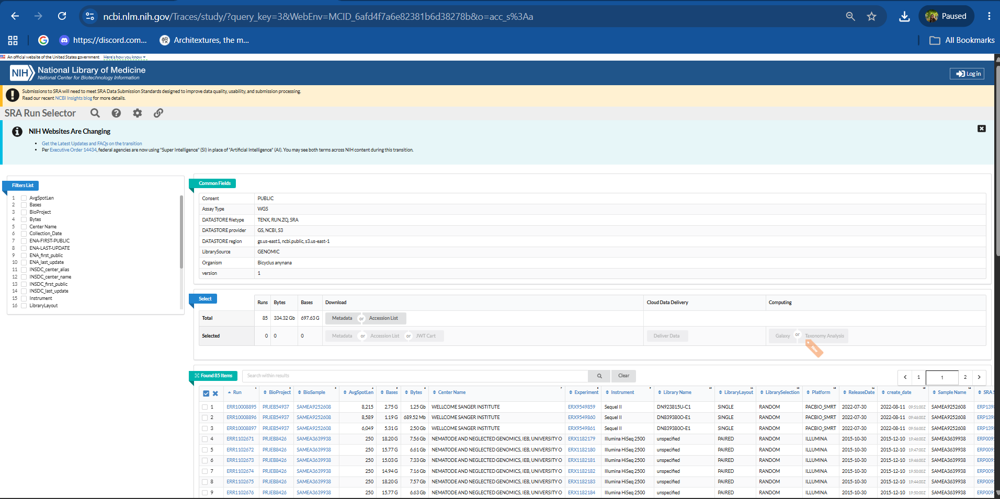

*Figure 5. SRA Run Selector showing available Bicyclus anynana sequencing runs and file sizes.*

---

## 4. Methodology

### 4.1 Data Retrieval

The chromosome-level reference genome assembly GCF_947172395.1 was obtained from NCBI Datasets.

The genomic FASTA and sequence report were downloaded from the same assembly. The sequence report was used to verify chromosome identifiers, including the Z chromosome.

Whole-genome paired-end DNA reads were selected from SRA run ERR754051.

### 4.2 Galaxy History and Data Import

**Galaxy platform:** https://usegalaxy.org

**History name:** Sex_Dosage_Bicyclus_anynana

**Galaxy history link:**  
https://usegalaxy.org/histories/view?id=bbd44e69cb8906b54963d7090b3439b5

The following procedures were performed:

1. Created a new Galaxy history named Sex_Dosage_Bicyclus_anynana.
2. Imported the genomic reference FASTA from assembly GCF_947172395.1.
3. Used Faster Download and Extract Reads in FASTQ to retrieve SRA run ERR754051.
4. Obtained the forward and reverse FASTQ reads as a paired-end collection.
5. Processed the reads using FastQC and fastp before alignment.

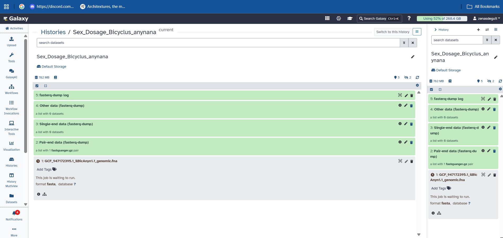

*Figure 6. Galaxy history showing the imported paired-end WGS reads and reference genome.*

### 4.3 FASTQ Quality Assessment

FastQC was used to assess the quality of both forward and reverse sequencing reads.

The reports showed acceptable per-base sequencing quality, but adapter-content failures were observed in both reads.

#### FastQC Summary

| Quality Assessment | Forward | Reverse |
|---|---|---|
| Per base sequence quality | Pass | Pass |
| Per sequence quality scores | Pass | Pass |
| Per base sequence content | Fail | Fail |
| Per sequence GC content | Fail | Warning |
| Overrepresented sequences | Fail | Pass |
| Adapter content | Fail | Fail |

These findings indicated that adapter trimming was appropriate before alignment.

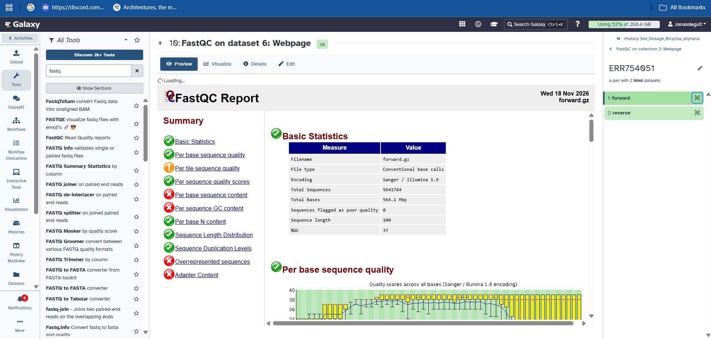

*Figure 7. Forward-read FastQC report showing sequencing quality and identified quality warnings or failures.*

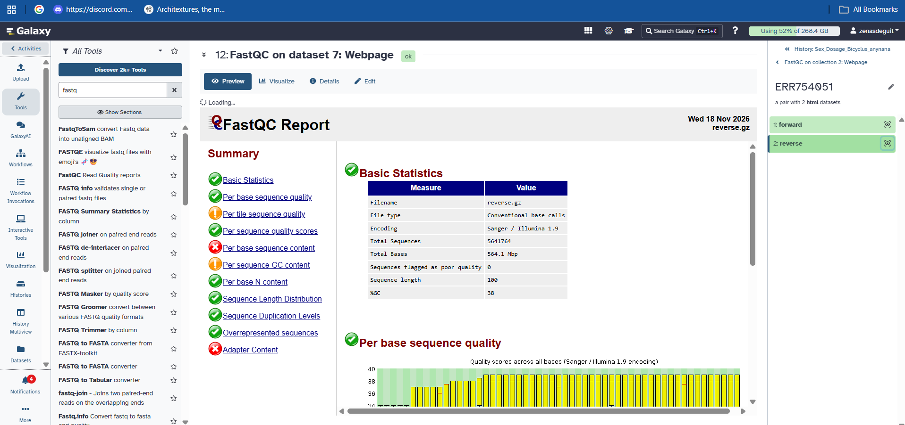

*Figure 8. Reverse-read FastQC report showing sequencing quality and adapter contamination.*

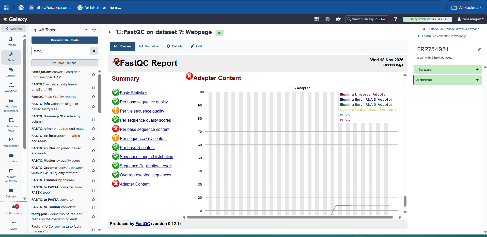

*Figure 9. FastQC adapter-content graph showing adapter contamination in the sequencing reads.*

### 4.4 Adapter Trimming Using fastp

The fastp tool was used to preprocess the paired-end WGS reads.

Settings included:

- Input: Paired-end FASTQ collection from ERR754051
- Merge forward and reverse reads: No
- Adapter trimming: Enabled
- Paired-end adapter auto-detection: Enabled
- Other trimming and filtering parameters: Default settings

The tool generated trimmed paired-end reads and HTML and JSON reports.

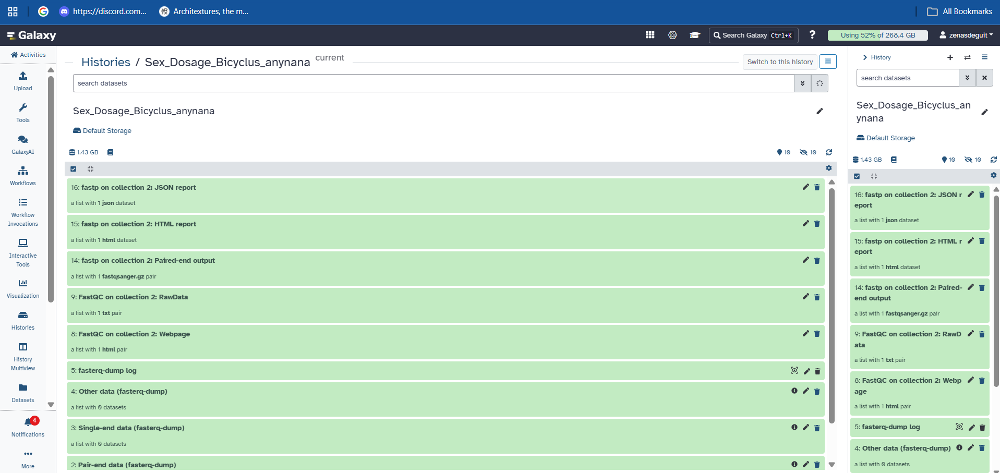

*Figure 10. Completed fastp processing in Galaxy, showing the trimmed paired-end reads and associated reports.*

### 4.5 Read Alignment Using BWA-MEM

The trimmed paired-end reads were aligned against the same NCBI reference genome using BWA-MEM.

Alignment settings:

| Parameter | Setting |
|---|---|
| Alignment tool | BWA-MEM |
| Reference source | Genome from Galaxy history |
| Reference assembly | GCF_947172395.1 |
| Reference FASTA | GCF_947172395.1_ilBicAnyn1.1_genomic.fna |
| Index construction | Auto |
| Reads | Trimmed paired-end collection from ERR754051 |
| BAM sorting | Sort by chromosomal coordinates |
| Output format | BAM |

The resulting alignment was coordinate-sorted, and its BAM index was available for downstream analysis.

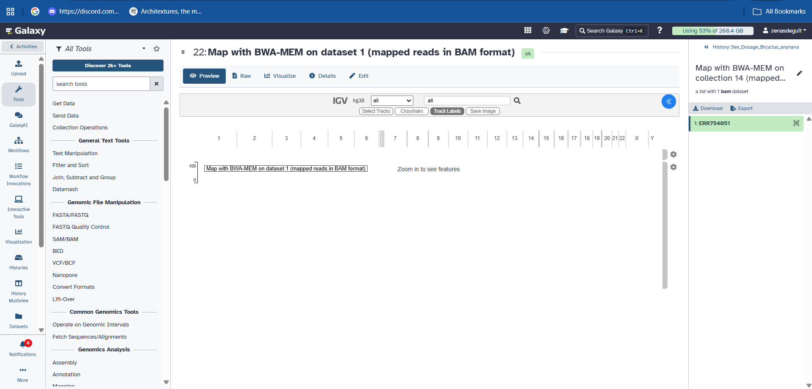

*Figure 11. Completed BWA-MEM alignment of trimmed WGS reads against the Bicyclus anynana reference genome.*

### 4.6 Alignment Quality Assessment

Samtools flagstat was used to examine the alignment statistics.

| Measurement | Result |
|---|---|
| Total alignment records | 8,694,640 |
| Mapped records | 8,272,781 |
| Mapped percentage | 95.15% |
| Properly paired records | 6,429,828 |
| Properly paired percentage | 74.93% |

The high mapping percentage indicates that most alignment records mapped to the selected reference genome.

Samtools idxstats was also used to verify chromosome identifiers and the presence of mapped reads on the autosomes and chromosome Z.

### 4.7 Chromosome Coverage Using Samtools

Samtools coverage was used to calculate sequencing depth across the reference chromosomes.

The selected parameters were:

| Parameter | Setting |
|---|---|
| BAM input | BWA-MEM alignment, dataset 22 |
| Pool BAM files | No |
| Minimum read length | 0 |
| Minimum mapping quality | 20 |
| Minimum base quality | 20 |
| Require flags | None |
| Exclude flags | None in the successful run |
| Histogram | No (tabular output) |

The initial coverage attempts produced empty files. The successful run was obtained after clearing the optional excluded-read flags while retaining the required quality thresholds.

The resulting tabular coverage data were downloaded and saved as chromosome_coverage.tsv.

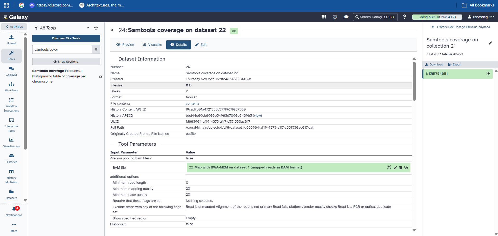

*Figure 12. Successful Samtools coverage output containing chromosome identifiers and mean sequencing-depth values.*

---

## 5. Chromosome Classification

Chromosomes were identified using the NCBI sequence report for assembly GCF_947172395.1 and verified against the Samtools coverage output.

Five autosomes and one Z chromosome were selected.

| Reference sequence | Chromosome group | Mean depth |
|---|---|---|
| NC_069083.1 | A | 1.27133 |
| NC_069084.1 | A | 1.14175 |
| NC_069085.1 | A | 1.28667 |
| NC_069086.1 | A | 1.21717 |
| NC_069087.1 | A | 1.28042 |
| NC_069110.1 | Z | 0.692138 |

The five numbered chromosomes were classified as autosomes (A), while NC_069110.1 was identified as chromosome Z.

Unplaced genomic scaffolds and other non-autosomal sequences were excluded from the chromosome-group file.

### chromosome_groups.csv

```csv
rname,group
NC_069083.1,A
NC_069084.1,A
NC_069085.1,A
NC_069086.1,A
NC_069087.1,A
NC_069110.1,Z
```

The chromosome_groups.csv file is included in this repository.

---

## 6. R Analysis

R was used to calculate the median autosomal sequencing depth, the Z:A ratio, and the inferred sex-chromosome complement.

The R script uses base R without additional packages.

### Complete R Script: sex_depth_analysis.R

```r
# Sex-chromosome dosage from whole-genome DNA read depth
# Input: Samtools coverage TSV + student chromosome labels
cov <- read.delim("chromosome_coverage.tsv", comment.char = "",
                  check.names = FALSE, stringsAsFactors = FALSE)
names(cov)[1] <- "rname" # Accepts the '#rname' header
if (!"meandepth" %in% names(cov)) stop("Missing meandepth column")
key <- read.csv("chromosome_groups.csv", stringsAsFactors = FALSE)
if (!all(c("rname", "group") %in% names(key))) stop("Bad key columns")
key$rname <- trimws(key$rname)
key$group <- toupper(trimws(key$group))
if (anyDuplicated(key$rname)) stop("Repeated rname in key file")
if (!all(key$group %in% c("A", "X", "Y", "Z", "W")))
  stop("Use only A, X, Y, Z or W in the group column")

x <- merge(key, cov[, c("rname", "meandepth")],
           by = "rname", all.x = TRUE, sort = FALSE)
x$meandepth <- suppressWarnings(as.numeric(x$meandepth))
if (anyNA(x$meandepth)) stop("Missing depths: check rname matches")
if (any(x$meandepth < 0)) stop("Negative depth is not valid")
if (sum(x$group == "A") < 5) stop("Label at least 5 autosomes")
if ("X" %in% x$group && "Z" %in% x$group)
  stop("Choose either an XY or a ZW species, not both")
if (sum(x$group == "X") == 1 && !any(x$group == "Z")) {
  target <- "X"
  one_copy <- "XY-like"
  two_copies <- "XX-like"
} else if (sum(x$group == "Z") == 1 && !any(x$group == "X")) {
  target <- "Z"
  one_copy <- "ZW-like"
  two_copies <- "ZZ-like"
} else stop("Label exactly one X or exactly one Z chromosome")

A <- median(x$meandepth[x$group == "A"])
if (!is.finite(A) || A <= 0) stop("No usable autosomal coverage")
x$relative_depth <- x$meandepth / A
ratio <- x$relative_depth[x$group == target]
call <- if (ratio >= 0.80) two_copies else if (ratio <= 0.65)
  one_copy else "Ambiguous"
if (A < 1) call <- "Inconclusive: very low autosomal depth"

# Additional Y or W evidence can support, but not prove, a call
partner <- if (target == "X") "Y" else "W"
partner_ratio <- if (partner %in% x$group)
  x$relative_depth[x$group == partner][1] else NA_real_

# Export results and a simple, reproducible figure
dir.create("results", showWarnings = FALSE)
write.csv(x, "results/chromosome_relative_depth.csv", row.names = FALSE)
png("results/chromosome_depth.png", width = 1000, height = 580)
par(mar = c(8, 4, 3, 1))
barplot(x$relative_depth, names.arg = x$rname, las = 2,
        ylab = "Depth relative to median autosome",
        main = "Autosomal and sex-chromosome depth", cex.names = 0.75)
abline(h = c(0.5, 1.0), lty = 2)
dev.off()

summary <- c(paste("Median autosome depth:", round(A, 3)),
             paste(target, "/ A ratio:", round(ratio, 3)),
             paste(partner, "/ A ratio:", round(partner_ratio, 3)),
             paste("Dosage interpretation:", call),
             "Compare with BioSample sex and discuss limitations.")
writeLines(summary, "results/sex_inference.txt")
cat(paste(summary, collapse = "\n"), "\n")
```

### Running the Script

The following files were placed in the same folder:

- chromosome_coverage.tsv
- chromosome_groups.csv
- sex_depth_analysis.R

The analysis was executed using:

```bash
Rscript sex_depth_analysis.R
```

The script generated:

- results/chromosome_relative_depth.csv
- results/chromosome_depth.png
- results/sex_inference.txt

---

## 7. Results

### 7.1 Chromosome-Depth Analysis

The R analysis produced the following values:

| Measurement | Result |
|---|---|
| Median autosomal depth | 1.271 |
| Z:A ratio | 0.544 |
| W:A ratio | NA |
| Inferred sex-chromosome complement | ZW-like |

The median sequencing depth of the five selected autosomes was approximately 1.271.

Chromosome Z had a mean sequencing depth of approximately 0.692.

The Z:A ratio was calculated by dividing the mean sequencing depth of chromosome Z by the median autosomal depth.

**Z:A = 0.692138 / 1.27133 = approximately 0.544**

A Z:A ratio close to 0.5 is consistent with one copy of chromosome Z relative to the two-copy autosomal complement.

The result therefore supports a ZW-like sex-chromosome complement.

### 7.2 Chromosome-Depth Figure

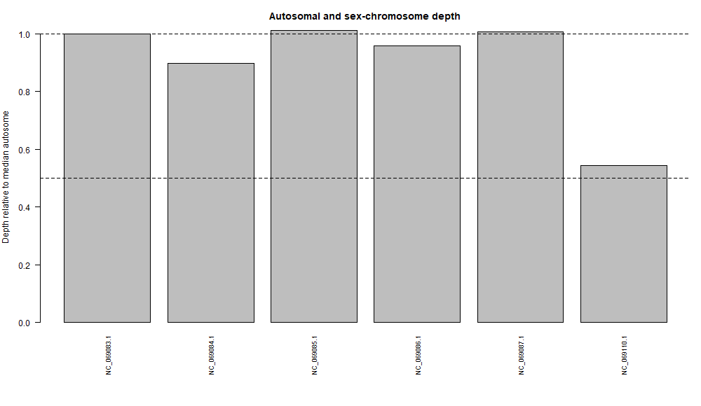

*Figure 13. Relative sequencing depth of five autosomes and chromosome Z in Bicyclus anynana. The autosomes show relative depths near 1.0, while chromosome Z has a lower relative depth of approximately 0.544. Dashed lines indicate relative depths of 0.5 and 1.0.*

### 7.3 Comparison With WGS BioSample Metadata

The WGS BioSample SAMEA3245887 is described in the European Nucleotide Archive as DNA obtained from a female Bicyclus anynana butterfly.

The sample title also identifies the donor as female.

This agrees with the ZW-like sex-chromosome complement inferred from the sequencing-depth ratio.

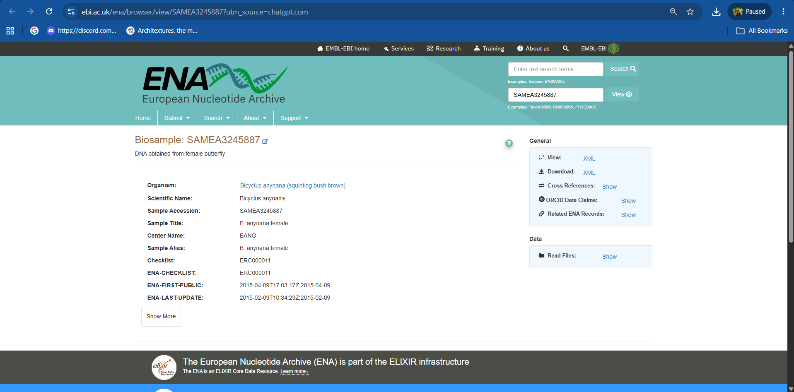

*Figure 14. ENA BioSample record identifying the WGS donor as a female Bicyclus anynana.*

---

## 8. Answers to the Laboratory Questions

### Question 1. What species did you choose, and what evidence supports a diploid XX/XY or ZZ/ZW system?

The selected species was Bicyclus anynana, commonly known as the squinting bush brown butterfly.

It is a normally diploid butterfly with a ZZ/ZW sex-chromosome system. Males typically have ZZ chromosomes, while females have ZW chromosomes.

The chromosome-level NCBI assembly identifies chromosome Z as NC_069110.1. This provides a reference for examining sex-chromosome dosage using genomic sequencing reads.

### Question 2. What are your assembly accession, WGS run, and both BioSample accessions? Are the donors the same?

The reference genome assembly accession is GCF_947172395.1, with assembly BioSample SAMEA9252597.

The WGS run accession is ERR754051, with WGS BioSample SAMEA3245887.

The assembly and WGS BioSample accessions are different. Therefore, the samples are treated as different donors, and the sex-chromosome inference applies to the WGS donor.

### Question 3. Which sequences were used as autosomes and as X or Z? How did you verify their identities?

Five autosomes were used:

- NC_069083.1
- NC_069084.1
- NC_069085.1
- NC_069086.1
- NC_069087.1

Chromosome Z was identified as NC_069110.1.

The chromosome identities were verified using the NCBI sequence report for assembly GCF_947172395.1 and matched against the reference names in the Samtools coverage output.

Only identified autosomes and the Z chromosome were included in chromosome_groups.csv.

### Question 4. What are the median autosomal depth, X:A or Z:A ratio, and inferred sex-chromosome complement?

The median autosomal depth was approximately 1.271, while the Z:A ratio was 0.544.

Because the ratio is close to 0.5 and below the classroom threshold of 0.65, the R script classified the WGS donor as ZW-like.

This is consistent with a female sex-chromosome complement under the ZZ/ZW system.

### Question 5. Does your result agree with the recorded sex of the WGS donor, if reported? Explain any discrepancy or uncertainty.

Yes. The result agrees with the WGS donor's recorded sex.

The ENA BioSample record SAMEA3245887 identifies the donor as a female Bicyclus anynana butterfly.

The inferred ZW-like sex-chromosome complement agrees with this recorded information.

Although the results agree, the inference is based on relative sequencing depth and may still be affected by low sequencing coverage, mapping biases, and other technical limitations.

The assembly donor is different from the WGS donor, so the result does not establish the sex of the reference assembly donor.

### Question 6. Why is a chromosome-level assembly alone insufficient for a reliable read-depth sex inference?

A chromosome-level assembly identifies and organizes the chromosomes of a reference genome, but it does not provide the sequencing-depth measurements required to infer the sex-chromosome complement of a WGS donor.

Read-depth analysis requires whole-genome DNA reads to be aligned against the reference assembly.

The sequencing depth of the sex chromosome must then be compared with the sequencing depth of autosomes.

Chromosome lengths or the reference assembly alone cannot reliably determine whether the individual supplying the WGS reads has one or two copies of a sex chromosome.

---

## 9. Limitations

Several factors may affect the accuracy of chromosome-depth analysis:

1. Low sequencing depth may introduce uncertainty into the depth estimates.
2. Repetitive genomic regions can cause mapping bias.
3. Pseudoautosomal regions and poorly differentiated sex chromosomes may affect expected depth ratios.
4. Missing W-chromosome sequences limit direct evaluation of W-chromosome coverage.
5. Reference assembly errors may affect read mapping and chromosome identification.
6. Unusual karyotypes may produce ratios that differ from the expected diploid patterns.
7. The assembly and WGS samples came from different BioSamples, so the inference applies only to the WGS donor.

The classroom Z:A cutoffs are teaching guidelines rather than diagnostic thresholds.

The W:A value was unavailable because a W chromosome was not included in the selected chromosome groups.

The median autosomal depth was approximately 1.271, indicating relatively low overall sequencing depth.

Despite these limitations, the Z:A ratio agreed with the sex recorded in the WGS BioSample metadata.

---

## 10. Conclusion

The sex-chromosome dosage of Bicyclus anynana was successfully analyzed using NCBI reference data, WGS reads processed in Galaxy, and chromosome-depth calculations performed in R.

The analysis produced a median autosomal depth of 1.271 and a Z:A ratio of 0.544.

The lower sequencing depth of chromosome Z compared with the autosomes supports a ZW-like sex-chromosome complement.

This result agrees with the ENA BioSample metadata identifying the WGS donor as female.

The activity demonstrates how chromosome-level reference genomes and whole-genome sequencing reads can be used together to estimate sex-chromosome dosage.

However, the interpretation remains subject to sequencing depth, mapping quality, and reference genome limitations.

---

## 11. Repository Contents

```text
CellMol_SexChrom_Bicyclus_anynana/
|
|-- README.md
|-- chromosome_groups.csv
|-- chromosome_coverage.tsv
|-- sex_depth_analysis.R
|
|-- results/
|   |-- chromosome_relative_depth.csv
|   |-- chromosome_depth.png
|   |-- sex_inference.txt
|
|-- screenshots/
    |-- 01_genome_assembly.png
    |-- 02_assembly_details.png
    |-- 03_chromosome_Z.png
    |-- 04_WGS_experiment.png
    |-- SRA_run_selector.png
    |-- 05_galaxy_WGS_import.png
    |-- 06_fastqc_forward.png
    |-- 06_fastqc_reverse.png
    |-- 07_fastqc_adapter_content.png
    |-- 07_fastp_completed.png
    |-- 08_BWA_MEM_alignment.png
    |-- 09_samtools_coverage.png
    |-- 10_WGS_BioSample_sex.png
```

The repository contains the chromosome classification, R analysis script, input coverage data, results, and screenshots documenting the laboratory workflow.

Large sequencing and alignment files, including FASTA, FASTQ, BAM, and CRAM, are not uploaded to GitHub.

---

## 12. References

1. National Center for Biotechnology Information (NCBI). Bicyclus anynana genome assembly GCF_947172395.1.  
   https://www.ncbi.nlm.nih.gov/datasets/genome/GCF_947172395.1/

2. NCBI. Bicyclus anynana chromosome Z, accession NC_069110.1.  
   https://www.ncbi.nlm.nih.gov/nuccore/NC_069110.1

3. NCBI Sequence Read Archive. WGS sequencing run ERR754051.  
   https://www.ncbi.nlm.nih.gov/sra/?term=ERR754051

4. European Nucleotide Archive. Bicyclus anynana BioSample SAMEA3245887.  
   https://www.ebi.ac.uk/ena/browser/view/SAMEA3245887

5. Galaxy Project. Galaxy analysis platform.  
   https://usegalaxy.org/

6. Galaxy Training Network. Introduction to NGS Data Management.  
   https://training.galaxyproject.org/training-material/topics/introduction/tutorials/galaxy-intro-ngs-data-managment/tutorial.html

7. Samtools Documentation. Samtools coverage.  
   https://www.htslib.org/doc/samtools-coverage.html

8. Sex-chromosome coverage review.  
   https://pmc.ncbi.nlm.nih.gov/articles/PMC6900093/
